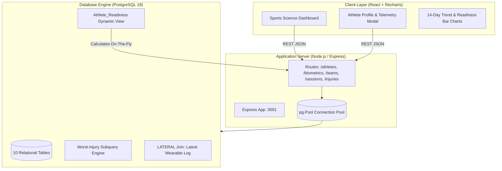

# Athlete Performance & Sports Science Intelligence Platform 🏋️‍♂️📊

> **A real-time, AI-driven Sports Science & Biometric Analytics Engine with PostgreSQL 18, Express REST API, and interactive React UI.**

[](https://www.postgresql.org/)
[](https://nodejs.org/)
[](https://react.dev/)
[](https://vitejs.dev/)
[](https://recharts.org/)

---

## 📖 Executive Summary & Academic Context

Built for a university **Database Systems & Applied Software Engineering** curriculum, this platform models an elite sports science training environment (resembling Whoop, Catapult Sports, and Firstbeat).

Rather than computing readiness in transient application memory, the platform delegates complex mathematical scoring directly to a high-performance **PostgreSQL Dynamic View** (`Athlete_Readiness`) with `LATERAL` joins and scalar subqueries. When sports medicine staff log an injury or coaches record new wearable telemetry, the entire system recalculates readiness scores and injury risk flags in sub-millisecond response times.

---

## 🏛️ System Architecture



---

## 🔬 Mathematical AI Readiness Formula

The **Readiness Score ($R \in [0, 100]$)** models physiological recovery:

$$R = \max\left(0, \min\left(100, \text{Base} - P_{\text{injury}}\right)\right)$$

### 1. Base Score Components (Weightings)
* **Sleep Quality Score (30%)**: $S \times 0.30$ — Essential for endocrine restoration and glycogen replenishment.
* **Heart Rate Variability (25%)**: $\min(\text{HRV}_{\text{ms}}, 100) \times 0.25$ — Measures vagal autonomic tone; capped at 100ms.
* **Fatigue Score (25%)**: $(10 - F) \times 10 \times 0.25$ — Subjective neuromuscular fatigue inverted to 0–100 scale.
* **Hydration Level (20%)**: $H_{\%} \times 0.20$ — Critical for plasma volume and cardiovascular drift prevention.

### 2. Dynamic Injury Penalty Matrix ($P_{\text{injury}}$)
* **Active + Severe Injury**: $-40\text{ points}$ (Prohibits full-contact training)
* **Active + Moderate Injury**: $-20\text{ points}$ (Significant workload modification)
* **Active + Minor Injury**: $-10\text{ points}$ (Managed load)
* **Recovering / Cleared**: $0\text{ points}$ (Penalty instantly lifts)

### 3. Injury Risk Flag
Independent early warning indicator derived from raw physiological signals:
* **High**: Fatigue $> 7.0$ OR Sleep $< 40\%$
* **Moderate**: Fatigue $> 5.0$ OR Sleep $< 60\%$
* **Low**: Normal physiological equilibrium

---

## 🗄️ Relational Database Schema (3NF)

The database schema comprises **10 normalized tables**:

1. `Coach` — Coaching staff identity & credentials
2. `Team` — Squads (`Thunder Hawks`, `Iron Wolves`) assigned to coaches
3. `Athlete` — Biometric roster linked to teams
4. `Athlete_Position` — Composite key position assignments (`Point Guard`, `Striker`, etc.)
5. `Emergency_Contact` — Emergency guardian contacts
6. `Biometric_Log` — Wearable time-series logs (HR, HRV, Sleep, VO2 Max, Fatigue, Hydration)
7. `Training_Session` — Practice and scrimmage events logged by coaching staff
8. `Athlete_Session` — Attendance and subjective Rate of Perceived Exertion (RPE 1-10)
9. `Drill_Telemetry` — Micro-level drill telemetry (sprint velocity, jump height)
10. `Injury_Record` — Sports medicine records with severity and clearance lifecycle

---

## ⚡ Quickstart & Local Installation

### Prerequisites
* PostgreSQL 18+
* Node.js v18+ & npm

### 1. Database Setup
```bash
# Clone the repository
git clone https://github.com/ABD15-444/Athlete-Performance-Sports-Science-Intelligence-Platform.git
cd Athlete-Performance-Sports-Science-Intelligence-Platform

# Execute SQL setup scripts in order
export PGPASSWORD=your_password
psql -U postgres -c "CREATE DATABASE athlete_platform;"
psql -U postgres -d athlete_platform -f database/schema.sql
psql -U postgres -d athlete_platform -f database/views.sql
psql -U postgres -d athlete_platform -f database/seed.sql
```

### 2. Backend API Setup
```bash
cd backend
cp .env.example .env
# Configure DB credentials in .env
npm install
npm run dev
# Server boots on http://localhost:3001
```

### 3. Frontend React Dashboard Setup
```bash
cd ../frontend
npm install
npm run dev
# Dashboard available on http://localhost:3000
```

---

## 🧪 Comprehensive API Documentation

| Method | Endpoint | Description |
| :--- | :--- | :--- |
| `GET` | `/api/health` | Health check & DB connection pool ping |
| `GET` | `/api/athletes` | Live roster with dynamically computed readiness & risk flags |
| `GET` | `/api/athletes/:id` | Full composite athlete profile (bio, sessions, injuries, contacts) |
| `POST` | `/api/athletes` | Register a new athlete with position & emergency contact |
| `POST` | `/api/athletes/:id/biometrics` | Log daily wearable telemetry; flags acute overtraining |
| `GET` | `/api/teams` | List all teams and sport types |
| `GET` | `/api/teams/:id/overview` | Aggregated roster metrics (average readiness, injury counts) |
| `GET` | `/api/sessions` | Fetch scheduled training sessions |
| `POST` | `/api/sessions` | Create a training session |
| `POST` | `/api/sessions/:id/athletes` | Log athlete participation & RPE |
| `GET` | `/api/injuries` | List injuries filtered by status and severity |
| `POST` | `/api/athletes/:id/injury` | Record injury (triggers automatic database readiness penalty) |
| `PATCH` | `/api/injuries/:id/status` | Update injury status (`Cleared` removes penalty instantly) |

---

## 🎯 Verification Matrix

* ✅ **Database Engine**: All 10 tables created with foreign key integrity, check constraints, and indexed `LATERAL` joins.
* ✅ **Dynamic Recalculation**: Clearing an injury (`Elena Petrov`) instantly restored readiness score from `64.30` to `74.30`.
* ✅ **Overtraining Alerts**: High fatigue ($>7$) and low sleep ($<40\%$) trigger automatic alerts.
* ✅ **Production UI**: Dark sports-tech theme with Recharts 14-day trends, squad comparison bars, and live injury clearance controls.