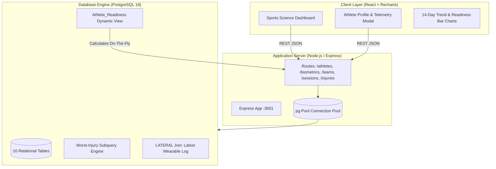

# Athlete Performance & Sports Science Intelligence Platform 🏋️‍♂️📊

> **A real-time, AI-driven Sports Science & Biometric Analytics Engine with PostgreSQL 18, Express REST API, and interactive React UI.**

[](https://www.postgresql.org/)
[](https://nodejs.org/)
[](https://react.dev/)
[](https://vitejs.dev/)
[](https://recharts.org/)

---

## 📖 Executive Summary & Academic Context

Built for a university **Database Systems & Applied Software Engineering** curriculum, this platform models an elite sports science training environment (resembling Whoop, Catapult Sports, and Firstbeat).

Rather than computing readiness in transient application memory, the platform delegates complex mathematical scoring directly to a high-performance **PostgreSQL Dynamic View** (`Athlete_Readiness`) with `LATERAL` joins and scalar subqueries. When sports medicine staff log an injury or coaches record new wearable telemetry, the entire system recalculates readiness scores and injury risk flags in sub-millisecond response times.

---

## 🏛️ System Architecture



---

## 🔬 Mathematical AI Readiness Formula

The **Readiness Score ($R \in [0, 100]$)** models physiological recovery:

$$R = \max\left(0, \min\left(100, \text{Base} - P_{\text{injury}}\right)\right)$$

### 1. Base Score Components (Weightings)
* **Sleep Quality Score (30%)**: $S \times 0.30$ — Essential for endocrine restoration and glycogen replenishment.
* **Heart Rate Variability (25%)**: $\min(\text{HRV}_{\text{ms}}, 100) \times 0.25$ — Measures vagal autonomic tone; capped at 100ms.
* **Fatigue Score (25%)**: $(10 - F) \times 10 \times 0.25$ — Subjective neuromuscular fatigue inverted to 0–100 scale.
* **Hydration Level (20%)**: $H_{\%} \times 0.20$ — Critical for plasma volume and cardiovascular drift prevention.

### 2. Dynamic Injury Penalty Matrix ($P_{\text{injury}}$)
* **Active + Severe Injury**: $-40\text{ points}$ (Prohibits full-contact training)
* **Active + Moderate Injury**: $-20\text{ points}$ (Significant workload modification)
* **Active + Minor Injury**: $-10\text{ points}$ (Managed load)
* **Recovering / Cleared**: $0\text{ points}$ (Penalty instantly lifts)

### 3. Injury Risk Flag
Independent early warning indicator derived from raw physiological signals:
* **High**: Fatigue $> 7.0$ OR Sleep $< 40\%$
* **Moderate**: Fatigue $> 5.0$ OR Sleep $< 60\%$
* **Low**: Normal physiological equilibrium

---

## 🗄️ Relational Database Schema (3NF)

The database schema comprises **10 normalized tables**:

1. `Coach` — Coaching staff identity & credentials
2. `Team` — Squads (`Thunder Hawks`, `Iron Wolves`) assigned to coaches
3. `Athlete` — Biometric roster linked to teams
4. `Athlete_Position` — Composite key position assignments (`Point Guard`, `Striker`, etc.)
5. `Emergency_Contact` — Emergency guardian contacts
6. `Biometric_Log` — Wearable time-series logs (HR, HRV, Sleep, VO2 Max, Fatigue, Hydration)
7. `Training_Session` — Practice and scrimmage events logged by coaching staff
8. `Athlete_Session` — Attendance and subjective Rate of Perceived Exertion (RPE 1-10)
9. `Drill_Telemetry` — Micro-level drill telemetry (sprint velocity, jump height)
10. `Injury_Record` — Sports medicine records with severity and clearance lifecycle

---

## ⚡ Quickstart & Local Installation

### Prerequisites
* PostgreSQL 18+
* Node.js v18+ & npm
* Python 3.10+ (with `psycopg2-binary`)

### 1. Database Setup
```bash
# Clone the repository
git clone https://github.com/ABD15-444/Athlete-Performance-Sports-Science-Intelligence-Platform.git
cd Athlete-Performance-Sports-Science-Intelligence-Platform

# Execute SQL setup scripts in order
export PGPASSWORD=your_password
psql -U postgres -c "CREATE DATABASE athlete_platform;"
psql -U postgres -d athlete_platform -f database/schema.sql
psql -U postgres -d athlete_platform -f database/views.sql
psql -U postgres -d athlete_platform -f database/seed.sql
psql -U postgres -d athlete_platform -f database/expanded_seed.sql
psql -U postgres -d athlete_platform -f database/advanced_programmability.sql
```

### 2. Backend API Setup
```bash
cd backend
cp .env.example .env
# Configure DB credentials in .env
npm install
npm run dev
# Server boots on http://localhost:3001
```

### 3. Frontend React Dashboard Setup
```bash
cd ../frontend
npm install
npm run dev
# Dashboard available on http://localhost:3000
```

### 4. Python Database Connectivity Client
```bash
# Direct Python connectivity testing
python3 python_client/athlete_db_client.py
```

---

## ⚙️ Advanced Database Programmability (PL/pgSQL)

Located in [`database/advanced_programmability.sql`](file:///Users/abrahamdavid/.gemini/antigravity-ide/scratch/athlete-platform/database/advanced_programmability.sql):

### 1. Functions (2)
* **`fn_calculate_readiness_score(sleep, hrv, fatigue, hydration, penalty)`**: Computes the sports science readiness score clamped to $[0, 100]$.
* **`fn_get_athlete_injury_risk(fatigue, sleep)`**: Categorizes acute injury risk into `'High'`, `'Moderate'`, or `'Low'`.

### 2. Procedures (2)
* **`sp_log_training_session_with_attendance(session_id, date, type, duration, intensity, athlete_ids[], default_rpe)`**: Atomically logs a training session and populates athlete attendance with transaction control.
* **`sp_clear_athlete_injuries(athlete_id, cleared_date)`**: Bulk-updates active injuries to `'Cleared'`, dynamically lifting readiness penalties.

### 3. Cursor (1)
* **`fn_scan_high_risk_athletes_cursor()`**: Uses an explicit PL/pgSQL `CURSOR` (`cur_athletes CURSOR FOR SELECT ...`) to iterate across the athlete population, evaluate latest biometrics, and return high-risk cases needing intervention.

### 4. Triggers (2)
* **`trg_biometric_overtraining` (on `Biometric_Log`)**: Intercepts inserts; if fatigue $>7$ or sleep $<40\%$, automatically creates an audit record in `Biometric_Alert_Audit`.
* **`trg_injury_status_audit` (on `Injury_Record`)**: Intercepts `Recovery_Status` updates (`Active` $\rightarrow$ `Cleared`) and logs status transitions for sports medicine accountability.

---

## 📊 Meaningful Analytical SQL Queries (15 Suite)

Located in [`database/meaningful_queries.sql`](file:///Users/abrahamdavid/.gemini/antigravity-ide/scratch/athlete-platform/database/meaningful_queries.sql):
1. **Squad Physiological Overview**: Multi-table join with roster aggregates (HRV, Sleep, Resting HR).
2. **Readiness Leaderboard**: Dynamic classification of recovery tiers across all athletes.
3. **Window Function Rank**: `DENSE_RANK() OVER (PARTITION BY Team_Name)` and squad variance.
4. **7-Day Rolling Moving Average**: `AVG(...) OVER (ROWS BETWEEN 6 PRECEDING AND CURRENT ROW)` for HRV and sleep.
5. **High Exertion Filter**: `HAVING COUNT(...) >= 3 AND AVG(RPE) >= 7.0`.
6. **Correlated Subquery Peak Speeds**: Identifies velocity leaders per drill type.
7. **Active Injury Burden**: Computes penalty point deductions and pre-injury baseline scores.
8. **Acute Fatigue Surge Detector**: CTE comparing today's fatigue against 7-day baseline to detect spikes $>1.5$.
9. **Position-Wise Benchmarks**: Compares VO2 Max and HRV across positions (`Forward`, `Guard`, `Sprinter`).
10. **Training Volume Load**: Aggregates cumulative minutes and attendance by session type.
11. **Emergency Contact Roster**: Medical preparedness join for high-risk/injured athletes.
12. **Historical Recovery Duration**: Analyzes average days to recovery per injury type.
13. **Sleep Duration vs Fatigue**: Groups sleep into categories to correlate against neuromuscular fatigue.
14. **Coaches Managing Critical Athletes**: Identifies coaches whose squads have athletes below readiness threshold.
15. **Cross-Drill Telemetry Averages**: Evaluates speed, acceleration, and distance across drill variations.

---

## 🐍 Python Database Connectivity

Located in [`python_client/athlete_db_client.py`](file:///Users/abrahamdavid/.gemini/antigravity-ide/scratch/athlete-platform/python_client/athlete_db_client.py):
* Direct PostgreSQL connectivity using `psycopg2`
* Executes queries against the live view `Athlete_Readiness`
* Invokes stored procedure `sp_clear_athlete_injuries`
* Consumes cursor function `fn_scan_high_risk_athletes_cursor`

---

## 🎯 Verification Matrix

* ✅ **10+ Records per Table**: All 10 tables contain $\ge 10$ meaningful records (seed + expanded seed).
* ✅ **15 Meaningful SQL Queries**: Tested and validated on live PostgreSQL 18 instance.
* ✅ **2 Functions & 2 Procedures**: Compiles and executes cleanly in PL/pgSQL.
* ✅ **1 Explicit Cursor**: Implemented in `fn_scan_high_risk_athletes_cursor()`.
* ✅ **2 Event Triggers**: Auditing overtraining alerts and medical recovery status transitions.
* ✅ **Python Connectivity**: Verified end-to-end with `psycopg2`.
* ✅ **Full-Stack Application**: Node.js/Express API + React 19 / Recharts dashboard.